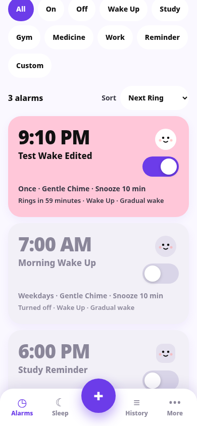

# Alarm — Wake up gently

Alarm is an alarm app prototype designed around waking up gently instead of being shouted awake.

## What it does

- Alarms organised in pastel categories with a next alarm countdown, repeat rules, a gradual wake option, snooze limits, and vibration patterns.
- Six synthesized wake sounds with previews.
- Optional wake challenges: maths, or tap the blobs.
- A sleep timer, and a history view that only reports what actually happened, including missed alarms.

## Status

Working prototype, built November 2026. Stated honestly inside the app: if the app is fully closed it cannot ring like a built-in alarm.

## Showcase only

This repository is a showcase. It contains no source code and no build files, and nothing here is open source. The screenshot(s) above are showcase images only. See NOTICE.md.

## Contact

Built by Yash Dashrath, Pune, India.

- Email: yashdashrath18@gmail.com
- LinkedIn: https://www.linkedin.com/in/yash-dashrath
- Yash MediaWorks: https://www.linkedin.com/company/yashmediaworks/
